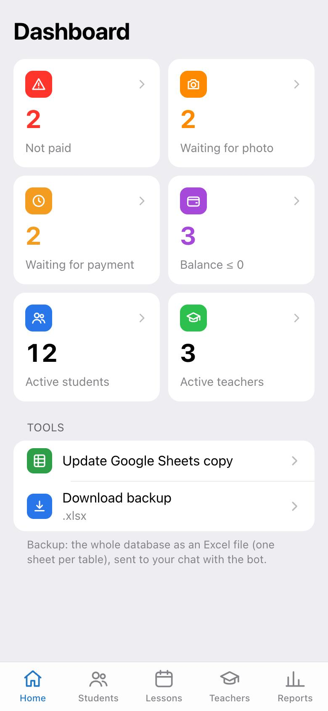
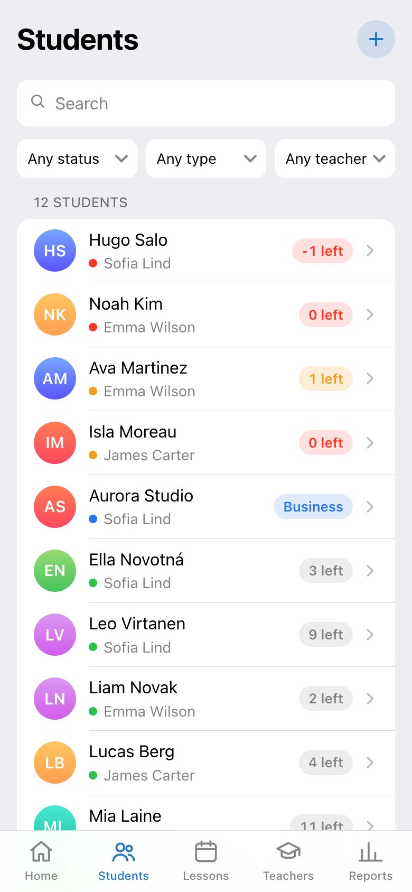
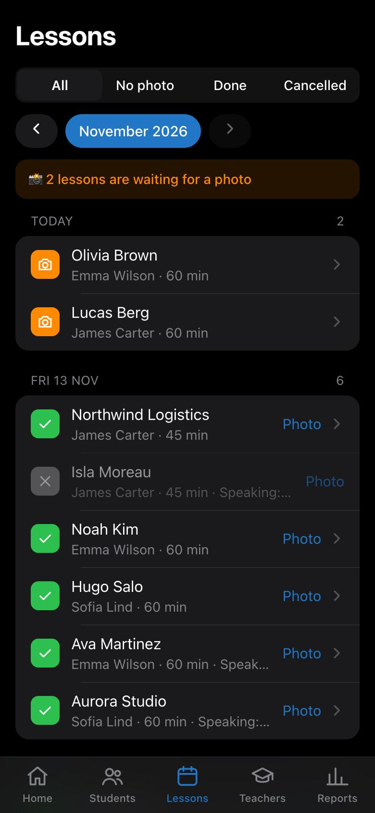
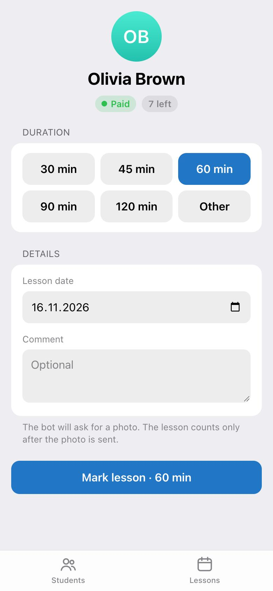
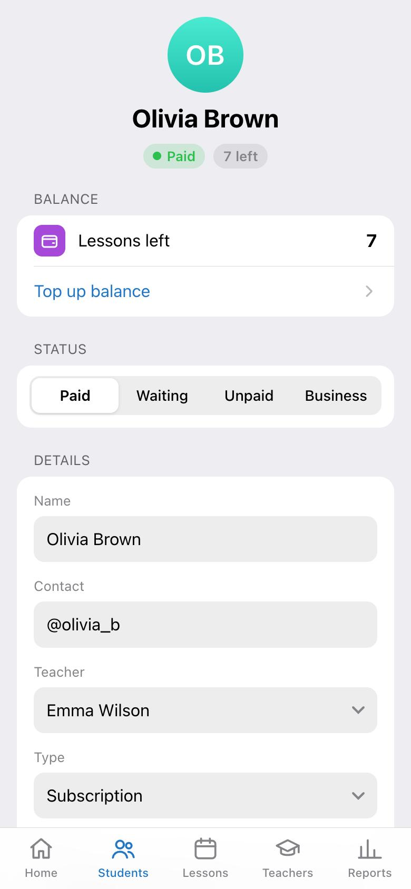
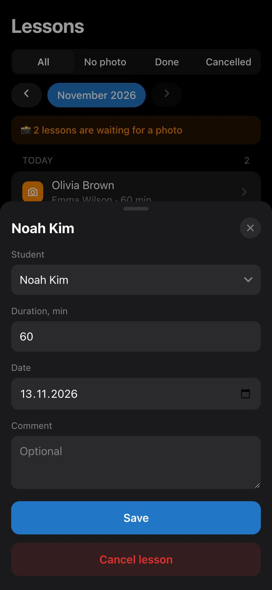
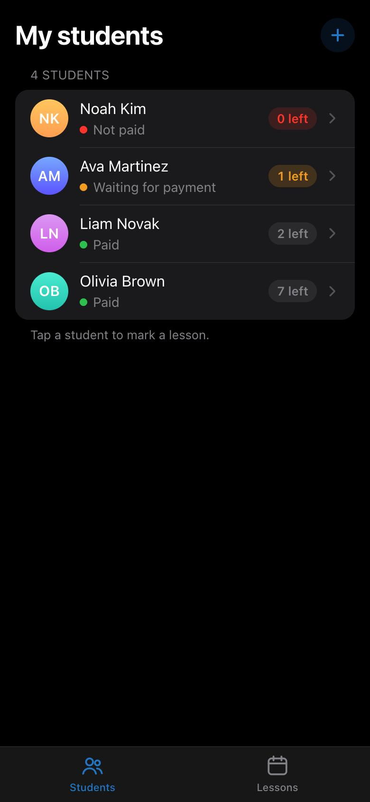
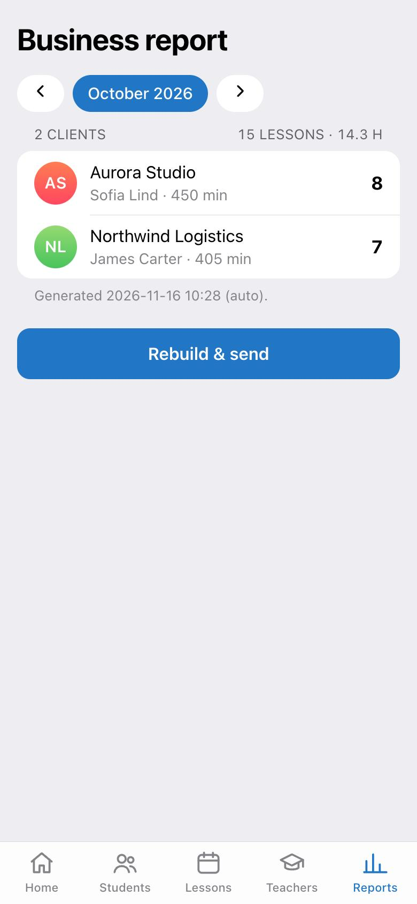
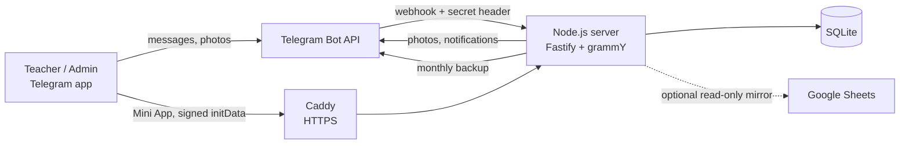

# Viby School Admin

[](https://github.com/geraldikus/VibyAdminTGBot/actions/workflows/ci.yml)

A Telegram bot and Mini App that runs the day-to-day operations of **Viby School**, an online English school:
teachers mark lessons from their phone, the system charges prepaid lesson packages, keeps photo proof of every lesson,
reminds people when something is missing and builds the monthly report for business clients.

It is in production use by the school's admin and teachers (around 200 lessons a month) and runs on a 1 GB VPS
next to another service.

<table>
  <tr>
    <td></td>
    <td></td>
    <td></td>
    <td></td>
  </tr>
  <tr>
    <td align="center"><sub>Admin dashboard</sub></td>
    <td align="center"><sub>Students and balances</sub></td>
    <td align="center"><sub>Lessons by day (dark theme)</sub></td>
    <td align="center"><sub>Teacher marks a lesson</sub></td>
  </tr>
</table>

<sub>Screenshots use generated demo data (`npm run seed:demo`), not real students.</sub>

## The problem

The school tracked lessons and prepaid packages in a Google Sheet, written to by a bot. As the school grew,
the sheet stopped being reliable:

- A lesson cancellation was two separate writes. If the second one failed, the lesson stayed "done" while it had already been refunded, and a retry refunded it again.
- A teacher's double tap on a bad connection created two lessons.
- The bot found rows among non-empty lines but wrote by row number, so clearing a row by hand could make the next update overwrite **another student's** data.
- Two quick `/start` messages could create the same teacher twice and lock them out.
- Reports, reminders and the photo channel had similar race conditions.

I listed 16 such issues and traced them back to one root cause: **a spreadsheet was being used as a database**
(no transactions, no unique keys, no stable row addresses). Patching each one would have meant writing
a small database on top of Sheets.

## The solution

- **SQLite as the source of truth.** Every operation that touches money (charging, refunding, moving a lesson to another student) runs in one transaction and re-checks the state inside it, so retries and double taps are harmless.
- **Telegram as the interface.** Teachers mark a lesson in the Mini App, the bot asks for a photo, the photo goes to a private channel, and only then is the lesson counted.
- **Google Sheets as an optional, read-only mirror** for people who like spreadsheets. The bot never reads it back.

## Features

**For teachers**
- See their students with a remaining-lessons badge; the most urgent first.
- Mark a lesson in two taps (native Telegram main button), then send the photo to the bot.
- Edit or cancel within a short window; add their own students.

**For the admin**
- Dashboard with tappable counters: unpaid, waiting for payment, balance ≤ 0, lessons without a photo.
- Student cards: status, top-ups, full lesson and balance history.
- Lessons by day with a month filter and pagination; edit, move or cancel with a bottom sheet.
- Approve teachers, monthly business-client report, one-tap Excel backup to the chat.
- Settings screen: reminder timings, edit window, how far back lessons can be marked.

**Automation**
- Photo reminders to the teacher and an alert to the admin if the photo never arrives.
- "Check payment" reminder when a student has been waiting for payment for N days (configurable), repeated until the status changes.
- Status turns red when a package runs out and back to green after a top-up.
- Business report on the 1st of the month, rebuilt later if teachers mark last month's lessons late.
- Nightly database backup on the server; monthly Excel + database copy delivered to Telegram.

<table>
  <tr>
    <td></td>
    <td></td>
    <td></td>
    <td></td>
  </tr>
  <tr>
    <td align="center"><sub>Student card</sub></td>
    <td align="center"><sub>Edit lesson</sub></td>
    <td align="center"><sub>Teacher's students</sub></td>
    <td align="center"><sub>Business report</sub></td>
  </tr>
</table>

## Architecture



| Part | Stack |
|---|---|
| Mini App | React, TypeScript, Vite, Telegram Web App API, hand-written CSS on Telegram theme variables |
| Server | Node.js 22, TypeScript, Fastify, grammY, better-sqlite3, node-cron, exceljs, zod |
| Shared | Types and validation schemas used by both sides (`shared/`) |
| Infrastructure | Docker (multi-stage, esbuild bundle), Caddy, Ubuntu VPS, GitHub Actions |

## Engineering decisions

**SQLite instead of Postgres.** The VPS has 1 GB of RAM shared with another bot. SQLite gives transactions, unique
constraints and `ON CONFLICT` without another process; one writer process makes `better-sqlite3` transactions truly atomic.

**Idempotency everywhere money is involved.** The Mini App generates a `client_id` once per lesson form, so a retry
after a lost response returns the same lesson. Confirming, cancelling and moving a lesson re-read the row inside the
transaction; a second request becomes a no-op. A duplicate channel post from a race is deleted.

**Telegram side effects outside transactions.** Sending a photo to the channel cannot be rolled back, so it happens
before the transaction; if the transaction then fails, the post is deleted.

**Security.** Mini App requests are authenticated by verifying Telegram's `initData` HMAC (timing-safe, 24 h expiry).
The webhook requires Telegram's secret header; the URL contains no secret. The photo channel is never switched
automatically. Production refuses to start without admin IDs and a strong webhook secret.

**State that survives restarts.** Pending "which lesson is this photo for?" choices and photo-replace mode live in the
database with a 10-minute expiry, not in process memory.

**Small footprint.** The server is bundled with esbuild at build time, so the container runs one `node` process (~90 MB).
Logs are rotated; the image is built on the developer machine and streamed to the server.

**Migration without downtime surprises.** A one-time importer moved the existing Google Sheets data, normalising dates
regardless of the sheet locale and checking that every balance equals the sum of its balance log before switching over.

## Testing

```bash
npm test
```

54 [Vitest](https://vitest.dev) tests in [`server/test`](server/test), each file on its own temporary database with a fake Telegram API:

- the same `client_id` twice → one lesson;
- two simultaneous photo confirmations → one charge, duplicate post deleted;
- repeated cancellation → one refund; moving a lesson → balances shift once;
- overlapping reminder runs → one message;
- payment reminder: due after N calendar days, repeats every N days, stops when the status changes, off at 0;
- business report rebuilt → no duplicates, late lessons counted in their month;
- Telegram `initData` signature (valid, tampered, expired), role checks, webhook secret.

GitHub Actions runs the type-check, the build, the tests and a Docker image build on every push.

## Run it locally

Requires Node.js 22+. No Telegram bot is needed for the demo:

```bash
npm install
```

```bash
npm run seed:demo
```

```bash
npm run demo
```

Open http://localhost:5173 — you are signed in as the admin of a fictional school.
To see the teacher view, run `localStorage.devUser = "teacher:1001:<teacher_id>"` in the browser console
(the teacher ID is printed by the seed script).

Running with a real bot, deployment, backups and the Google Sheets import are described in
[docs/operations.md](docs/operations.md).

## Project structure

```
server/   Fastify API, Telegram bot, services, SQLite schema, scheduler, tests
web/      Telegram Mini App (React)
shared/   Types and zod schemas shared by server and web
deploy/   docker-compose, deploy script, Caddy snippet
docs/     Operations guide and screenshots
```

## How I worked with AI

I built this with Claude Code as a pair programmer. My part was the product and engineering judgement:

- finding the failures with the real users and turning them into a concrete list of 16 issues;
- deciding what to change and what not to (SQLite over Postgres, no approval step for teacher-added students, monthly instead of nightly backups to Telegram, keeping the git history);
- reviewing every change, running it against real and demo data, and checking that the tests actually fail when the logic is broken;
- planning and executing the production move next to a live service, one confirmed step at a time.

## What I learned

- Most "random" bugs in small business tools come from the storage model, not from the business logic. Fixing the root cause removed half of the list at once.
- Idempotency is a user-experience feature: on mobile networks every button will be pressed twice.
- Small infrastructure needs the same care as big infrastructure: health checks, log rotation, backups that leave the server, and a rollback path for every change.
